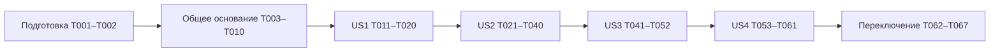

# Задачи — Отбор, Подпитка и закрытие с отгрузкой

**Ветка** `codex/011-outbound-workflows`
**Основание** [spec.md](spec.md), [plan.md](plan.md), [data-model.md](data-model.md), [контракты](contracts/), [исследование](research.md).

В этом файле одна задача означает один проверяемый инкремент. Пути указаны относительно корня репозитория. Новые имена файлов уточняются в T002. При переименовании обновлять ссылки в задачах. Числа FR и SC отсылают к спецификации.

Общие ограничения каждой команды следуют из конституции. Состояние, аудит и квитанция сохраняются согласованно. Для складского события к ним добавляются движения, остатки и обороты. Отдельное повторное действие использует новый идентификатор запроса, потеря ответа на прежнее действие сохраняет его идентификатор.

Сборки, выполнение автоматических тестов, создание и применение миграций, запуск приложений и проверку устройства выполняет разработчик по AGENTS.md. Агент готовит изменения, минимальные команды и проверяет сообщённые результаты и созданные миграции. Перед добавлением теста сверить имеющиеся проверки по политике `.specify/memory/architecture.md`. Задачи тестов ниже защищают только указанные риски потери или дублирования товара и состояния.

Маркер [P] указывает возможность работы параллельно с независимой задачей после общих предпосылок. Он не разрешает одновременно менять общие файлы. После задачи оставить короткую передачу с результатом, проверкой и следующей зависимостью.

## Фаза 1. Подготовка

Использовать существующие проекты. Новый процесс напрямую заменяет легаси в разрабатываемой системе.

- [x] T001 Зафиксировать в `specs/011-outbound-workflows/research.md` места удаления легаси ShippingOrder и зависимые отчёты. Новый сценарий напрямую заменяет старый, без переноса незавершённой работы.

- [x] T002 Уточнить технические имена новых сущностей, исполнителей и DTO в `specs/011-outbound-workflows/data-model.md` и `specs/011-outbound-workflows/contracts/mobile-v1.md` по существующему CommandExecutor. Сохранить решения о последовательных строках, отсутствии If-Match и одной кнопке закрытия/повтора. Новые пути далее обозначают планируемые файлы.

## Фаза 2. Общая модель и защита складского состояния

Основание для всех четырёх сценариев. Количества сохраняют точность 0,001. Квитанции и аудит используют существующий CommandExecutor.

- [x] T003 Создать общую модель ограничений в `Wms.Domain/PickingReservation.cs`, `Wms.Domain/StockShortage.cs` и расширить `Wms.Domain/StorageLocationLock.cs`. Ключ резерва включает склад, ячейку, SKU, nullable срок и запись Отбора. «Не имеет TTL». «В одной ячейке не более одного активного эксклюзивного удержания». Владелец удержания указан явно, блок недостачи освобождается отдельно.

- [x] T004 Создать используемую несколькими сценариями модель задания и циклов в `Wms.Domain/ReplenishmentTask.cs`, `Wms.Domain/ReplenishmentSourceCycle.cs`, `Wms.Domain/ReplenishmentTransfer.cs`. Хранить сборку, SKU, заказ, проведение, время запроса, исполнителя, рекомендуемые и фактические адреса, группу срока и MovementId. «Проведённый шаг не редактируется». Закрытие сборки сохраняет самостоятельное задание.

- [x] T005 Сопоставить общие сущности EF в `Wms.Infrastructure/Data/Configurations/` и `Wms.Infrastructure/Data/ApplicationDbContext.cs`. Защитить уникальные активные удержания, ссылки на владельцев, nullable группы и точность количества. Использовать существующий контекст и общую цепочку миграций.

- [x] T006 Реализовать общий запрос доступности в `Wms.Application/Inventory/GetStockAvailability.cs` и его EF чтение в `Wms.Infrastructure/Data/StockAvailabilityStore.cs`. Вычитать все активные резервы, исключать спорную часть и чужое удержание. Различать новое выделение и проведение собственного резерва. Группа null остаётся отдельной. FR-018, FR-038.

- [x] T007 Добавить конкурентную запись ограничений в `Wms.Infrastructure/Data/StockAvailabilityStore.cs` через существующую сессию `Wms.Infrastructure/Data/CommandExecutionStore.cs`. Охватить чтение доступности и изменение резерва/удержания одной границей записи, в том числе отсутствующие строки. При удержании всей ячейки проверить чужие резервы всех SKU/сроков и повысить OperationalRevision.

- [x] T008 Подготовить датированное проведение выдачи, переноса и корректировки в `Wms.Infrastructure/Data/InventoryPostingStore.cs` с использованием существующего `InventoryBalance.Adjust` в `Wms.Domain/InventoryBalance.cs`. Сохранять движения, оба остатка при переносе, обороты, ревизии ячеек и аудит в сессии команды. Правила владельца удержания применяются к его действию. Сохранить проверки Приёмки в `Wms.Application/Inventory/PostInventoryMovement.cs`.

- [x] T009 Подключить ограничения доступности к новому пути записи в `Wms.Application/Inventory/PostInventoryMovement.cs` и `Wms.Infrastructure/Data/InventoryPostingStore.cs`. Защитить чужие резервы и удержанные адреса при Отборе, Подпитке, корректировке и новых Приёмке/Размещении. Легаси Перемещение и Инвентаризация будут заменены отдельно. FR-018, FR-020.

- [x] T010 Проверить имеющиеся гарантии в `Wms.Tests/Infrastructure/CommandExecutorTests.cs` и расширить `Wms.Tests/Inventory/StockAvailabilitySafetyTests.cs`, `OutboundInventoryPostingSafetyTests.cs` и `NewInventoryPostingTests.cs` проверками конкуренции резерва и нового проведения, защиты владельца удержания и атомарности выдачи/переноса/корректировки. Подтвердить отсутствие повторного списания и двойного вычитания удержания.

Основание T001–T010 готово. Миграция AddOutboundReservationsAndReplenishment проверена. Разработчик подтвердил успешный запуск трёх проверок модели, девяти проверок доступности/экзекутора и 24 проверок нового проведения и регрессии Приёмки/Размещения. Следующий блок — US1. Ссылки на будущие таблицы сборки и записей Отбора добавляются в T012/T021.

## Фаза 3. US1 — Создать и начать мультиордерную сборку (P1)

Проверяемый результат — два свободных РО 1С одного склада образуют сборку со своим номером. Частичный переход в КОтбору блокирует физическую работу и допускает продолжение. Критерии SC-001, SC-006, SC-017, SC-025, SC-031.

- [x] T011 [P] [US1] Создать `Wms.Domain/PickingAssembly.cs`, `Wms.Domain/PickingAssemblySourceLink.cs` и `Wms.Domain/PickingAssemblyPlanLine.cs` с собственной идентичностью, номером, складом, ревизией, ответственным и историей связей. «Один активный источник принадлежит не более одной сборке, включая ожидающую отмену/обратный обмен». «Неотрицательные количества с точностью до 0,001; уникальная строка по документу и SKU». Сохранять исходные строки и реквизиты распоряжений для последующего PATCH. FR-002–004.

- [x] T012 [US1] Добавить конфигурации сборки, связей и плана в `Wms.Infrastructure/Data/Configurations/` и `Wms.Infrastructure/Data/ApplicationDbContext.cs`. Отделить новые складские поля от источника `Wms.Domain/ShippingOrder.cs` и подготовить удаление старых операционных полей при замене их потребителей. По подготовленной схеме запросить у разработчика создание миграции в `Wms.Infrastructure/Data/Migrations/`, изучить созданные Up/Down и ограничения перед её применением.

T011–T012: отдельная складская сборка, активная связь с источником и план по документу/SKU добавлены; миграция AddPickingAssemblies создана разработчиком и проверена по Up/Down. Старые операционные поля ShippingOrder сохраняются до переключения их потребителей. Разработчик подтвердил 9 проверок остатков и проведения без ошибок.

- [x] T013 [P] [US1] Перенести чтение и разбор РО 1С в `Wms.Integration/OneS/ShippingSourceReader.cs`, `Wms.Integration/OneS/ShippingSourceParser.cs` с прикладным контрактом `Wms.Application/Picking/IShippingSourceReader.cs`. Перенести текущие строки, Posted, пометку удаления, склад, операцию, получателя, очередь, дату и направление. Ошибку чтения отличать от нулевого плана.

- [x] T014 [US1] Реализовать `Wms.Application/Picking/SynchronizeShippingSource.cs` и подключить его к `Wms/Integration/OneS/NotifyBackgroundService.cs`. Уведомление обновляет источник. До попытки начала пересчитывается план привязанной сборки, после неё сохраняются только актуальные данные для сравнения. Автоматическое создание рабочей сборки уведомлением исключить при переключении. FR-004–005.

T013–T014: новый читатель 1С и синхронизация источника подключены к уведомлениям; успешное чтение сохраняет исходный JSON и обновляет черновой план, начатый план не меняет. Ошибка чтения или разбора сохраняется отдельно и не превращается в нулевой план. Миграция TrackCurrentShippingSource создана разработчиком и проверена по Up/Down. Проверка сборки хостов ожидается.

- [x] T015 [US1] Реализовать `Wms.Application/Picking/CreatePickingAssembly.cs`, `AttachPickingSource.cs`, `DetachPickingSource.cs` и EF доступ в `Wms.Infrastructure/Data/PickingAssemblyStore.cs`. Скан связанного источника возвращает сборку. Проверить подготовленность, проведение, склад и свободную связь. Последнее открепление отменяет пустой черновик с историей. После первой попытки начала связи фиксированы. FR-002–005.

T015: исполнители формирования и изменения связей добавлены. WebApi собран разработчиком; 22 предупреждения не остановили сборку. Клиент и маршруты будут подключены в T018–T019.

- [x] T016 [US1] Реализовать `Wms.Application/Picking/StartPickingAssembly.cs` и `Wms.Integration/OneS/ShippingSourceWriter.cs`. До запросов сохранить список документов и план, затем переводить каждый в КОтбору с проведением и отдельным результатом. Сетевой запрос выполняется вне складской транзакции. Частичный успех повторяется по оставшимся документам. Различить повтор потерянного ответа с прежним ID и новую попытку после известной ошибки. FR-005.

T016: первый запуск фиксирует состав и план до PATCH/POST, сохраняет намерение PATCH и результат каждого документа; повтор продолжает неподтверждённые документы, а та же завершённая команда не посылает запросы повторно. Короткая аренда предотвращает параллельные запуски. Миграция AddPickingStartProgress создана разработчиком и проверена по Up/Down; WebApi собран разработчиком без ошибок (22 предупреждения). Следующий шаг — чтение и передача сборки в T017, затем контракт и экран в T018–T019; проверки существенных рисков запланированы в T020.

- [x] T017 [US1] Реализовать `Wms.Application/Picking/GetPickingAssemblies.cs`, `GetPickingAssembly.cs` и `TakeOverPickingAssembly.cs`. Список показывает свои активные сборки; фильтр закрытых по неподтверждённому обмену завершается в T059 после появления `ShippingExchangeTarget`. Явная передача меняет единственного ответственного с ревизией, аудитом и уведомлением прежнего исполнителя при обновлении. Сохранить исполнителей записей факта. FR-019.

T017: список и карточка читают ответственного, ревизию, источники и план; передача начатой сборки требует Operator и ожидаемую ревизию, сохраняет аудит и не меняет прежние записи факта. Точное исключение закрытых сборок с подтверждённым обменом зависит от модели целей US2 и остаётся в T059; до появления закрытия этот случай недостижим. Разработчик подтвердил сборку WebApi без ошибок (22 предупреждения); проверка гонки передачи с физическим фактом запланирована в T040 после появления записи факта. Следующий шаг — Mobile V1 контракт и маршруты T018.

- [x] T018 [US1] Создать `Wms.Contracts/Mobile/V1/MobilePickingContracts.cs` и `Wms.WebApi/Mobile/MobilePickingEndpoints.cs` для чтения, скана/создания, связей, начала и передачи. Политика требует явного Operator в `Wms.WebApi/Program.cs`. Команды используют ClientRequestId. Подключение нового маршрута выполняется при общем переключении.

T018: Mobile V1 DTO и обработчики списка, скана, создания, связей, запуска и передачи подготовлены; десятичный штрихкод РО 1С разбирает новый Integration адаптер. Маршрут ещё не зарегистрирован согласно плану переключения. Разработчик подтвердил сборку WebApi без ошибок (22 предупреждения). Следующий шаг — клиент и экраны T019.

- [x] T019 [US1] Реализовать `Wms.Mobile/Services/MobilePickingClient.cs`, `Wms.Mobile/Pages/Picking/PickingAssemblyPage.xaml` и `PickingSourcesPage.xaml` с кодом страниц. Новая сборка открывает документы, существующая — SKU. Скан источника, частичное начало, явная передача и неясный ответ сохраняют состояние и ключ команды. Навигацию зарегистрировать при переключении. FR-001, FR-019.

T019: мобильный клиент, очередь сборок, состав РО 1С и начальная страница SKU подготовлены. Неясный ответ удерживает исходный ClientRequestId до подтверждённого результата; частичный запуск и передача сборки отображаются на экранах. Страницы зарегистрированы в DI, но вход с главного экрана и маршрут WebApi остаются отключены до общего переключения. Разработчик подтвердил сборку Mobile без ошибок (7 предупреждений). Следующий шаг — минимальные проверки существенных рисков T020.

- [x] T020 [US1] Добавить отсутствующие проверки в `Wms.Tests/Picking/PickingAssemblySafetyTests.cs` для параллельной привязки одного источника, неизменности начатого плана при уведомлении, частичного старта/повтора. Конкуренцию передачи с подтверждением факта проверить в T040 после реализации записи факта. Расширить существующую защиту квитанций без дублирования инфраструктурных тестов.

T020: две SQL-проверки защищают единственную активную привязку и восстановление после конфликта, а также замороженный план, частичный запуск и повтор без повторного PATCH. Выявленный тестом конфликт EF/SQL теперь возвращается как конфликт команды, включая обёрнутую ошибку deadlock 1205; новые связи и строки плана явно ставятся на вставку. Разработчик подтвердил 2/2 теста. Следующий инкремент — модель факта и целей обмена T021; проверка передачи во время физического Отбора остаётся в T040.

## Фаза 4. US2 — Выполнить Отбор и зафиксировать складское закрытие (P1)

Проверяемый результат — датированные записи удерживают товар, исправляются физическим возвратом и закрываются одним списанием. До подключения US4 подтверждать создание целей обмена через прикладной контракт. Подпитка из US3 проверяется совместно после её готовности. Критерии SC-002, SC-003, SC-007, SC-009–010, SC-012–016, SC-019–024, SC-026–027, SC-029, SC-040–042.

- [x] T021 [P] [US2] Создать `Wms.Domain/PickingEntry.cs`, `PickingAllocation.cs`, `PickingClosure.cs` и `ShippingExchangeTarget.cs`, их конфигурации в `Wms.Infrastructure/Data/Configurations/` и таблицы через `Wms.Infrastructure/Data/ApplicationDbContext.cs`. «Срок соответствует учётной группе; null не превращается в известную дату». «Сумма по документам для SKU строго равна проведённому факту WMS». Нулевой итог создаёт ноль движений. Цель обмена хранит Ref_Key, рассмотренный источник, целевые строки/статус и стадии отдельно по документу. Запросить создание и проверить миграцию разработчика.

T021: добавлены датированный факт Отбора, распределение по РО 1С, результат закрытия и отдельные цели обмена со стадиями. Фабрика закрытия сверяет итог каждого SKU и запрещает движения при нулевом факте; верхний предел по плану документа проверит команда распределения T031. Разработчик подтвердил сборку Infrastructure и создал миграцию AddPickingFactsAndExchangeTargets; её Up/Down и снимок модели проверены. Следующий независимый инкремент — сравнение адресов T022; проведение факта и завершение стадий обмена остаются в своих задачах.

- [x] T022 [P] [US2] Реализовать чистое сравнение адресов в `Wms.Application/Picking/PickingAddressComparer.cs`. Обычные адреса сравнивать по помещению, ряду, стойке, уровню, ячейке, нетиповые по Code со стабильным порядком. Учитывать существующих соседей у концов маршрута. Code и PickSequence сохраняются. FR-017.

- [x] T023 [US2] Реализовать `Wms.Application/Picking/BuildPickingRoute.cs` с доступностью из общей модели. FEFO выше остальных предпочтений, null после известных дат, просроченные группы исключены. Точное совпадение, малые остатки и выбранные точки адресного обхода следуют разделу маршрута spec.md. Для прямого палетного Отбора выбирать полные одно-SKU ячейки последовательно по убыванию подходящего остатка, с допустимым возвратом по маршруту. FR-017, FR-020.

T022–T023: чистый компаратор использует иерархию обычного Code с уровнем перед ячейкой; нетиповые адреса имеют отдельный стабильный порядок по Code. Построитель получает снимок общей доступности и метаданные ячеек, отдаёт рекомендованные шаги и непокрытую потребность; FEFO исключает просроченное и ставит null последним. Прямой палетный шаг требует полного доступного остатка одно-SKU ячейки и не обходит ранние сроки. Две проверки риска маршрута прошли у разработчика (2/2). Следующий блок — T024–T026: чтение фактического адреса, удержание палета и атомарное подтверждение Отбора.

- [x] T024 [US2] Реализовать `Wms.Application/Picking/GetPickingSku.cs` и `GetPickingSource.cs`. Скан фактического адреса проверяет SKU, зону, доступность, FEFO и срок, предлагает количество для оставшейся потребности. Чужой SKU показывается явно. Изменение учётной группы возможно только на уже учтённую дату, null требует визуальной проверки. Скан SKU необязателен, при наличии проверяется. FR-006, FR-017.

- [x] T025 [US2] Реализовать `Wms.Application/Picking/HoldPickingPallet.cs` и `ReturnPickingPallet.cs`. Скан источника удерживает всю ячейку до первого количества. Проверить один SKU, полное изъятие и отсутствие чужого резерва. Возврат при отмене подтверждается сканом и нулевым оставшимся фактом ячейки. Прерывание до первой записи также допускает возврат удержания. FR-020.

- [x] T026 [US2] Реализовать `Wms.Application/Picking/ConfirmPick.cs` с `Wms.Infrastructure/Data/PickingAssemblyStore.cs`. Количество положительное, группа срока известна учёту или null. Факт и резерв сохраняются вместе с ревизией ответственного, аудитом и квитанцией. Повтор и конкурентный выбор не превышают доступность. Маршрут перестраивается после результата. FR-006, FR-018.

T024–T026: прикладные запросы скана, удержание/возврат одно-SKU ячейки Хранения и подтверждение факта с резервом готовы. Проверка FEFO, роли и ревизии выполняется перед записью; резерв повторно проверяется под блокировкой ячейки. Разработчик подтвердил сборку Infrastructure. При подключении API/ТСД после команды нужно перечитать оставшуюся потребность и перестроить маршрут. Следующий инкремент — уменьшение факта и резерва T027.

- [x] T027 [US2] Реализовать `Wms.Application/Picking/ReducePick.cs`. При уменьшении потребовать скан первоначальной ячейки и подтверждение физического наличия возвращаемого количества. Атомарно уменьшить факт и резерв, сохранить причину/историю и обновить оставшийся маршрут. Движение остатков отсутствует. FR-018.

T027: команда возврата по исходной ячейке готова. Ревизия сборки, факт, резерв, аудит и квитанция сохраняются одним коммитом; остаток склада не меняется. Клиент после ответа перечитывает маршрут. Разработчик подтвердил сборку Infrastructure. Следующий инкремент — сообщение и разбор недостачи T028–T029.

- [x] T028 [US2] Реализовать `Wms.Application/Picking/ReportPickingShortage.cs`. Не смешивать частичный Отбор с явной недостачей. В одном сохранении учесть уже подтверждённую запись или фактически найденное количество один раз, резерв и блок спорной свободной группы. Сохранить ожидаемое/найденное количество, источник, исполнителя и необязательный комментарий. FR-018.

- [x] T029 [US2] Реализовать `Wms.Application/Inventory/ResolveStockShortage.cs` для Manager. Подтверждение недостачи создаёт датированную корректировку со ссылкой на сообщение и снимает блок в одном коммите. Ошибочный блок снимается решением без движения. Сохранить резервы фактически взятого товара и историю. FR-036.

T028–T029: команды сообщения и решения недостачи готовы. Новый факт резервируется один раз, спорный остаток блокируется отдельной записью; решение Manager либо проводит корректировку через общий путь, либо освобождает ошибочный блок. Аудит и квитанция сохраняются в той же сессии. Разработчик подтвердил сборку Infrastructure. Следующий инкремент — изменение плана и распределение факта T030–T031.

- [x] T030 [US2] Реализовать `Wms.Application/Picking/ChangePickingPlan.cs` для Manager. Менять количество и состав плана по документу с ревизией, просмотренными источниками и аудитом. Факт меняется физическими действиями Operator. Отразить новые/удалённые строки и сохранённые данные для восстановления 1С. FR-008.

- [x] T031 [US2] Реализовать `Wms.Application/Picking/AllocatePickingFact.cs`. При полном совпадении распределять по планам, единственный документ заполнять автоматически, недобор общего SKU оставлять для решения Manager. Количество по документу не выше его утверждённого плана, сумма строго равна факту SKU. Перед закрытием показать итог. FR-009, FR-012, FR-014.

T030–T031: команда Manager сверяет просмотренный снимок источника с текущей проекцией, меняет план выбранного документа под ревизией и записывает в аудит причину, хеш источника и изменения по SKU. Превью распределения автоматически заполняет однозначные случаи, а частичный общий SKU оставляет для явного решения Manager; оно проверяет потолок каждого документа и точное совпадение с фактом. До закрытия распределение остаётся превью, сохраняться будет в T033. Разработчик подтвердил сборку Infrastructure. Следующий инкремент — свежая сверка перед закрытием T032.

- [x] T032 [US2] Реализовать `Wms.Application/Picking/CheckPickingClosure.cs` и сравнение источников. Свежий GET всех документов обязателен, снятие проведения, иной склад/операция, неожиданный статус и пометка удаления блокируют обоих. Получателя рассматривает Manager, очередь/дата/направление обновляют отображение. Известные истёкшие сроки запрещают закрытие. FR-007–008, FR-021–023, FR-025.

T032: свежая сверка всех связанных РО 1С с разбором исходного снимка через Integration готова. Результат отдельно показывает непреодолимые блокировки, вопросы Manager, совпадение плана с фактом и превью распределения. Ошибка одного GET не скрывает остальные документы. Разработчик подтвердил сборку WebApi; T033 повторно проверяет ревизию и принятые снимки в БД перед складским коммитом.

- [x] T033 [US2] Реализовать `Wms.Application/Picking/ClosePickingAssembly.cs`. После проверки ревизии, собственного резерва, достаточного учётного остатка и чужих резервов одним коммитом списать датированные группы из первоначальных ячеек, сохранить обороты, итог, распределение, цели обмена, аудит/квитанцию, завершить резервы/удержания. Остаток зоны отгрузки отсутствует. Полностью набранная сборка может закрыться при начатой Подпитке. FR-009–016, FR-037.

T033: складская команда закрытия готова. Свежий GET выполняется до транзакции; внутри проверяются ревизия, снимки РО 1С, активные резервы и полное изъятие удержанных поддонов. Каждая запись факта проводится из исходной ячейки через общий обработчик, затем сохраняются распределение, итог, нейтральная цель обмена каждого документа, аудит и квитанция. Цель содержит утверждённый план/факт; конкретные строки OData строит T054. Разработчик подтвердил сборку WebApi и одну SQL-проверку отката при отказе второго списания с безопасным повтором того же запроса. Следующий инкремент — отмена незакрытой сборки T034.

- [x] T034 [US2] Реализовать `Wms.Application/Picking/CancelPickingAssembly.cs`. Требовать нулевой факт после сканов возврата и отсутствие незавершённой начатой Подпитки. Отменить предложения/не начатые заказы, сохранить проведённые пополнения. Зафиксировать ожидающий возврат статусов 1С и удерживать источник от повторной привязки до разрешения обмена. Невозможный возврат остаётся на ручном разборе.

T034: Manager отменяет складскую работу только после нулевого факта, снятия резервов и сканированного возврата поддонов. Заказанные, но не начатые Подпитки отменяются; начатые остаются в работе, а сборка — в `CancellationPending`. Не запускавшиеся источники освобождаются, подтверждённые и неопределённые PATCH остаются привязанными до безопасного обмена T058. Складских движений нет. Разработчик подтвердил сборку WebApi (22 предупреждения); минимальные проверки возврата и гонок относятся к T040. Следующий инкремент — Mobile V1 T035.

- [x] T035 [US2] Добавить запросы и команды Отбора/возврата/закрытия в `Wms.WebApi/Mobile/MobilePickingEndpoints.cs` и `Wms.Contracts/Mobile/V1/MobilePickingContracts.cs`. Для закрытой сборки выбирать сохранённую ветвь обмена, реализуемую в US4. Operator не получает права обхода расхождений. FR-007, FR-036.

T035: Mobile V1 выдаёт план и факт по SKU, маршрут с нехваткой, доступность и результат скана ячейки; команды удержания/возврата поддона, Отбора/возврата, недостачи и закрытия идут через прикладные экзекуторы. Operator не получает параметров Manager override. Повтор того же ID закрытия читает квитанцию и не списывает товар повторно; новая попытка для закрытой сборки пока возвращает понятную ошибку, её ветвь обмена подключит US4. Разработчик подтвердил сборку WebApi (22 предупреждения). Следующий инкремент — экраны ТСД T036.

- [x] T036 [US2] Реализовать `Wms.Mobile/Pages/Picking/PickingSkuPage.xaml`, `PickingRoutePage.xaml` и `PickingEntryPage.xaml` с кодом страниц. Показывать привычные цвета состояния и единицу SKU, предзаполненное количество с явным подтверждением, дату группы, причины доступности, сообщение о недостаче. Следующий шаг обновляет ту же карточку, Назад возвращает к исходному списку. Ожидание Подпитки сохраняет доступ к другим SKU. FR-006, FR-017–019.

T036: список SKU показывает план/факт и исходные записи возврата, маршрут остаётся рекомендацией, карточка проверяет скан и предлагает количество до явного подтверждения. Палетный шаг удерживает поддон, возврат факта сканирует исходную ячейку, недостача отправляется отдельной командой; после подтверждения карточка показывает следующий доступный шаг. Один ID команды удерживается до определённого ответа. Разработчик подтвердил Android-сборку с двумя предупреждениями; проверка навигации и сканера остаётся при запуске на устройстве. Следующий инкремент — Web Manager T037.

- [x] T037 [US2] Реализовать `Wms.WebApp/Components/Pages/PickingAssemblyPages/Index.razor`, `Details.razor`, `PickingPlanDialog.razor` и `PickingAllocationDialog.razor` с необходимыми code-behind. Показать план WMS, факт WMS и текущие источники, их реквизиты, распределение и аудит. Manager может изменить план и закрыть с разрешённым расхождением. Ручной ввод общего физического факта выполняется через ТСД ролью Operator. FR-008–009, FR-036.

T037: Web Manager видит список сборок, план по РО 1С, физический факт, актуальную проекцию 1С после сверки, распределение и аудит. Изменение плана и закрытие используют существующие экзекуторы; при неопределённом ответе идентификатор команды сохраняется для повтора. Разработчик подтвердил сборку WebApp с 18 предупреждениями. Следующий инкремент — разбор недостачи и отмена T038.

- [x] T038 [US2] Реализовать `Wms.WebApp/Components/Pages/PickingAssemblyPages/ShortageResolutionDialog.razor` и отмену в Details.razor. Показать группу срока, сообщение, удержанный факт, эффект корректировки и решение с причиной. Сохранить ID при неясном ответе. FR-036.

T038: Web Manager видит недостачу по группе срока, её сообщение и удержанный факт; подтверждение проводит корректирующее движение, ошибочный сигнал освобождает блокировку. Отмена доступна после возврата физического факта и остаётся ожидающей до завершения зависимостей. Для обоих решений неоднозначный ответ сохраняет исходный ID команды. Разработчик подтвердил сборку WebApp с 18 предупреждениями. Следующий инкремент — окно остатков SKU T039.

- [x] T039 [P] [US2] Реализовать окно «i» в `Wms.Mobile/Pages/StockKeepingUnits/SkuLocationsPage.xaml`, `Wms.WebApp/Components/Shared/SkuLocationsDialog.razor` и чтение через `Wms.WebApi/Mobile/MobileStockAvailabilityEndpoints.cs`. Подключить в существующие карточки/списки SKU за исключением списка подбора согласно FR-038. Основное число доступное, учётное показывать при отличии, доступ требует Operator.

T039: Operator открывает остатки SKU по ячейкам и учётным группам срока из Приёмки, Размещения и карточки факта Отбора; доступное количество показано первым, учётное — при отличии, единица явная. Web и Mobile используют общий прикладной расчёт, API допускает только Operator. Заодно зарегистрированы ранее не подключённые маршруты нового Отбора. Разработчик подтвердил сборки WebApi (17 предупреждений), WebApp (13) и Android (2). Следующий инкремент — ревизия критических проверок T040.

- [x] T040 [US2] Добавить отсутствующие проверки в `Wms.Tests/Picking/PickingPostingSafetyTests.cs` и `PickingReturnSafetyTests.cs`. Проверить собственный резерв 10 при свободных 0, атомарное списание нескольких групп, нулевое закрытие, повтор и гонку закрытия с правкой/передачей, конкуренцию передачи сборки с подтверждением физического Отбора, возврат со снятием резерва и снятие блока корректировкой. Для маршрута добавить в `Wms.Tests/Picking/PickingRouteSafetyTests.cs` только риск нарушения FEFO и двойного выделения, не копировать алгоритм тестами.

T040: SQL-проверки защищают атомарное списание двух групп, собственный резерв при нулевой свободной доступности, повтор без второго движения, закрытие с нулевым фактом, устаревшие команды после передачи сборки, сохранение резерва отобранного товара при корректировке недостачи и его снятие при сканированном возврате. Две проверки маршрута защищают FEFO и отсутствие двойного выделения. Разработчик подтвердил 5/5 тестов. Следующий инкремент — предложения Подпитки T041.

## Фаза 5. US3 — Заказать и выполнить Подпитку (P1)

Проверяемый результат — сразу виден полный список пополнений. Перенос становится доступен после подтверждения назначения, удержание источника живёт до возврата. Критерии SC-024, SC-028, SC-033–039, SC-041, SC-043.

- [x] T041 [P] [US3] Реализовать `Wms.Application/Replenishment/BuildReplenishmentProposals.cs` поверх оставшейся потребности и GetStockAvailability. Предлагать сразу все требуемые источники, учитывать уже выданные заказы и физически удержанные поддоны. Назначение предпочитает текущий SKU, затем историческую нулевую ячейку. Явно показывать общий дефицит. FR-028, FR-039.

T041: чистый расчёт использует остаточную потребность, уже рекомендованные шаги Отбора, доступность групп срока и существующие задания; возвращает предложения по источникам и явный дефицит, не создавая заказ. Проверка защищает от лишней Подпитки при существующем заказе и доступной более поздней группе в Комплектации. Разработчик подтвердил 1/1 тест. Следующий инкремент — явный заказ T042.

- [x] T042 [US3] Реализовать `Wms.Application/Replenishment/OrderReplenishment.cs` и `Wms.Infrastructure/Data/ReplenishmentStore.cs`. Только явное подтверждение создаёт заказ, повтор не создаёт дубль. Пересчёт рекомендаций сохраняет существующие заказы и их первоначальное время. FR-028, FR-039.

T042: Operator заказывает одно актуальное предложение с ревизией сборки; команда в одной транзакции пересчитывает маршрут и доступность, создаёт задание, аудит и квитанцию. Повтор того же ID возвращает прежний результат, а пересчёт предложений не меняет сохранённые задания. Разработчик подтвердил сборку Infrastructure с 9 предупреждениями. Следующий инкремент — выдача очереди T043.

- [x] T043 [P] [US3] Реализовать `Wms.Application/Replenishment/GetReplenishmentTasks.cs`. Сортировать перед выдачей по актуальному максимальному приоритету сборки ЖиваяОчередь → СобратьКДате → СобственнаяДоставка → не указана, затем по времени запроса со стабильным разрешением равенства. Начатые задания сохраняют исполнителя. FR-024.

T043: очередь читает актуальный тип очереди каждого активного источника 1С и выводит максимальный приоритет сборки; внутри сортирует по исходному времени заказа и ID задания. Начатые задания остаются закреплены за исполнителем. Разработчик подтвердил сборку Infrastructure с 9 предупреждениями. Следующий инкремент — скан источника T044.

- [x] T044 [US3] Реализовать `Wms.Application/Replenishment/StartReplenishmentSource.cs`. Скан допустимой ячейки Хранения удерживает всю ячейку с исполнителем и начинает задание атомарно. Проверить склад, активность, FEFO, остаток и чужие ограничения всех групп. Другой допустимый источник заменяет рекомендацию, оставшиеся не начатые заказы получают обновлённые рекомендации. FR-028, FR-034–035.

T044: скан источника сохраняет удержание ячейки, исполнителя и рекомендации остальных не начатых заданий в одной команде. Блок спорного количества не закрывает всю ячейку, а активный резерв любой группы препятствует удержанию поддона. Разработчик подтвердил сборку Infrastructure с 9 предупреждениями. Следующий инкремент — перенос T045.

- [x] T045 [US3] Реализовать `Wms.Application/Replenishment/ConfirmReplenishmentTransfer.cs`. Проверить скан назначения Комплектации и конечное смешение SKU. Проводить только SKU задания и одну группу срока, сохраняя шаг, движение, остатки, обороты, прогресс, аудит и квитанцию вместе. Удержание источника остаётся. «Несколько сроков — несколько шагов FEFO». FR-029, FR-034–035, FR-039.

T045: перенос сохраняет шаг, датированное движение, оба остатка, обороты, прогресс, аудит и квитанцию в одной транзакции. Источник остаётся удержанным. Разработчик подтвердил сборку Infrastructure с 9 предупреждениями. Следующий инкремент — недостача и завершение источника T046.

- [x] T046 [US3] Реализовать `Wms.Application/Replenishment/ReportReplenishmentShortage.cs` и `CompleteReplenishmentSource.cs`. Спорное количество блокировать отдельно, найденное разрешить перенести. Завершить поддон сканом того же адреса и подтверждением возврата/физической пустоты. Другие SKU требуют возврата. При неполном заказе сохранить задание для следующего источника. FR-030–032, FR-034.

T046: отдельный блок спорной группы не мешает переносу найденного; скан исходной ячейки завершает цикл, проверяя все SKU при подтверждении пустоты, и снимает только удержание поддона. Неполное задание сохраняет исполнителя и следующий цикл. Проверка сборкой ожидается от разработчика вместе с T047.

- [x] T047 [US3] Подключить жизненный цикл задания к `Wms.Application/Picking/CancelPickingAssembly.cs` и `ClosePickingAssembly.cs` через `Wms.Infrastructure/Data/ReplenishmentStore.cs`. До скана источника исчезнувший заказ отменяется, после скана он сохраняется до исполнения и окончания всех циклов. Отмена сборки ждёт завершения, закрытие полностью набранной сборки не ждёт. Физически невозможное выполнение остаётся на ручном разборе. FR-032, FR-037.

T047: отмена сборки уже отменяла не начатые задания и ждала начатых; закрытие теперь отменяет оставшиеся не начатые заказы в своей транзакции и сохраняет начатые. Завершение последней Подпитки закрывает ожидающую отмену после освобождения связей 1С. Разработчик подтвердил сборку Infrastructure с 9 предупреждениями. Следующий инкремент — управленческая корректировка T048.

- [x] T048 [US3] Реализовать `Wms.Application/Replenishment/CorrectReplenishmentTransfer.cs` и `Wms.WebApp/Components/Pages/PickingAssemblyPages/ReplenishmentCorrectionDialog.razor` для Manager. Коррекция — отдельное датированное движение с причиной и ссылкой на шаг. Учесть ограничения/резервы затронутых ячеек и сохранить первоначальный шаг. FR-033, FR-036.

T048: Manager вводит фактический итог проведённого шага и причину; разница проводится отдельным движением с регистратором шага, исходный факт не меняется. Общий обработчик проверяет остатки, резервы, блоки и удержания обеих ячеек; команда сохраняет прогресс задания, аудит и квитанцию вместе. Web показывает исходное и скорректированное количество, при неопределённом ответе повторяет тот же ID. Разработчик подтвердил сборку WebApp с 13 предупреждениями. Следующий инкремент — Mobile V1 T049.

- [x] T049 [US3] Создать `Wms.Contracts/Mobile/V1/MobileReplenishmentContracts.cs`, `Wms.WebApi/Mobile/MobileReplenishmentEndpoints.cs` и `Wms.Mobile/Services/MobileReplenishmentClient.cs`. Чтение и все физические команды используют явный Operator, общий протокол повторов, фактический источник/назначение и причину отказа. FR-036.

T049: Mobile V1 предоставляет предложения сборки, заказ, очередь и подробную карточку задания с фактическими источниками, группами срока и историей переносов. Скан источника, перенос, недостача и завершение поддона вызывают отдельные прикладные команды под ролью Operator; ответы используют существующие коды ошибок и ClientRequestId. Клиент зарегистрирован для T050–T051. Разработчик сообщил об успешной сборке с 22 предупреждениями; старые прямые вызовы конструктора закрытия в Wms.Tests обновлены после сообщения об ошибке.

- [x] T050 [US3] Реализовать `Wms.Mobile/Pages/Picking/PickingReplenishmentsPage.xaml` с кодом страницы. Белые предложения/заказы различать действием, жёлтый означает начало, зелёный — всё количество проведено в назначение даже до возврата поддона. Показывать частичное количество и знак готовности всех пополнений на кнопке. Обновление штатное. FR-039.

- [x] T051 [US3] Реализовать `Wms.Mobile/Pages/Replenishment/ReplenishmentQueuePage.xaml` и `ReplenishmentTaskPage.xaml` с кодом страниц. Показать приоритет, фактические адреса и группы срока, ввод/подтверждение, проведённое количество и незавершённый возврат при повторном открытии. Следующий источник доступен после завершения первого цикла. FR-028–035.

T050–T051: список сборщика различает предложение действием заказа и показывает прогресс отдельного задания; знак готовности появляется после проведения всего объёма без ожидания возврата поддона. Очередь подпитчика сортируется сервером по приоритету отгрузки; карточка читает циклы и группы из сохранённого задания, подтверждает сканы источника, назначения и возврата, перенос и недостачу. Повтор использует тот же ClientRequestId. Прямые вызовы ClosePickingAssembly в Wms.Tests обновлены. Разработчик подтвердил сборки Wms.Mobile и Wms.Tests; UI и устройство проверяются в T065.

- [x] T052 [US3] Добавить проверки в `Wms.Tests/Replenishment/ReplenishmentPostingSafetyTests.cs` и `ReplenishmentLifecycleSafetyTests.cs` для потери ответа и повтора переноса, двух источников, независимости блока недостачи, нескольких сроков/SKU, гонки отмены со сканом источника и продолжения после закрытия сборки. Перемещение и прогресс должны коммититься или откатываться вместе.

T052: SQL-проверка отката проваленного проведения защищает равенство прогресса, движения и квитанции; повтор подтверждённого переноса не создаёт второго движения. Две группы срока и другой SKU в источнике проверяют адресные остатки. Отдельная проверка сохраняет блок недостачи после пустого первого источника и завершает заказ из второго после закрытия сборки. Отмена и скан проверяются при обоих порядках коммита: отменённый заказ не снимает поддон, начатый сохраняет удержание и переводит сборку в ожидающую отмену. Проверки выявили необходимость явно добавить новый цикл и шаг переноса в EF-сессию, а при чтении связанных заданий использовать уже открытую транзакцию. Разработчик подтвердил 3/3 теста. Следующий инкремент — стадии обмена T053.

## Фаза 6. US4 — Завершить обмен каждого документа по закрытому факту (P1)

Проверяемый результат — один документ может завершить обмен при ошибке другого. Та же кнопка повторяет только неподтверждённые документы. Критерии SC-004–005, SC-008, SC-011, SC-018, SC-021, SC-030, SC-032, SC-044–046.

- [x] T053 [P] [US4] Завершить хранение стадий обмена в `Wms.Domain/ShippingExchangeTarget.cs` и `Wms.Infrastructure/Data/Configurations/ShippingExchangeTargetConfiguration.cs`, созданных в US2. Обеспечить ошибку, время и ревизию решения по Ref_Key, отдельный прогресс документа и подтверждение результата POST. Сохранённая цель US2 используется для повторов.

T053: переходы цели и ограничение стадий подготовлены; успешный PATCH не завершает обмен, ошибка POST сохраняет стадию для повтора, новое решение меняет только рассмотренный снимок и ревизию документа. Разработчик создал миграцию `AddShippingExchangeStageConstraint`; её Up/Down и снимок модели проверены, целевые тесты подтверждены. Следующий инкремент — построитель строк T054.

- [x] T054 [P] [US4] Реализовать `Wms.Integration/OneS/ShippingTargetBuilder.cs`. Количество SKU данного документа распределять последовательно по исходным строкам до исчерпания, сохраняя распоряжения и утверждённые пределы строк. Остаток оформлять НеОтгружать. При нуле все применимые строки НеОтгружать, таблица распоряжений пуста. Восстановление удалённых строк использует сохранённые реквизиты. FR-009, FR-012, SC-044.

T054: из неизменной цели закрытия и сохранённого исходного снимка строится PATCH с последовательным распределением SKU, остатком «НеОтгружать» и положительными строками распоряжений. При нулевом факте распоряжения пусты; удалённые строки восстанавливаются с реквизитами снимка. Отправляются только поля строк, используемые OData-записью. Разработчик подтвердил целевые тесты. Следующий инкремент — выполнение PATCH/POST T055.

- [x] T055 [US4] Завершить `Wms.Integration/OneS/ShippingSourceWriter.cs`. PATCH состава и Отгружен выполняется одним целевым обновлением, Posted читается, POST вызывает /Post. При совпадении строк и статуса PATCH пропускается. Ошибка/потеря ответа POST оставляет документ неподтверждённым и допускает новое проведение. PostingModeOperational=false явно не добавлять. If-Match не поддерживается и не требуется.

T055: адаптер строит целевой PATCH из сохранённого решения, сравнивает его со свежим РО 1С по статусу и строкам, пропускает совпавший PATCH и отдельно вызывает `/Post`. Текущий `Posted` доступен через чтение источника; ответ с ошибкой POST позволяет повторное проведение. Разработчик подтвердил 4/4 целевых тестов. Следующий инкремент — команда и хранение попыток T056.

- [x] T056 [US4] Реализовать `Wms.Application/Picking/ExchangeShippingDocument.cs` и `Wms.Infrastructure/Data/ShippingExchangeStore.cs`. Перед записью сверять свежий источник с рассмотренным состоянием либо достигнутой собственной целью. Новые строки/реквизиты требуют решения Manager, пометка удаления блокирует обмен до восстановления. Сериализовать попытки одного документа без удержания складской транзакции на время HTTP. FR-010–011, FR-026–027.

T056: попытка одного Ref_Key держит сеансовую блокировку SQL на время HTTP, а короткие команды сохраняют стадии, ошибки, аудит и квитанции без складской транзакции на время сети. Свежий источник должен совпадать с рассмотренным снимком либо достигнутой целью; новая правка требует Manager, пометка удаления блокирует запись. После PATCH и POST состояние проверяется повторным GET; успешный достигнутый и проведённый результат подтверждается без лишней записи. Разработчик подтвердил сборку Wms.Tests. Следующий инкремент — общая кнопка T057.

- [x] T057 [US4] Реализовать `Wms.Application/Picking/CloseAndShipPickingAssembly.cs` как точку входа кнопки. Для открытой сборки вызвать складское закрытие один раз и обмен целями, для закрытой — только обмен неподтверждённых документов. После принятого PATCH повторять POST. После известной ошибки следующая попытка имеет новый request ID, потерянный ответ команды повторяется с прежним ID. Сбой одного документа не останавливает остальные. FR-010–011, SC-045.

T057: единая команда для начатой сборки вызывает существующее складское закрытие с его квитанцией, затем проходит независимые цели РО 1С. Для уже закрытой сборки она обрабатывает только неподтверждённые документы; сбой одного не останавливает остальные. Квитанция ответа по ID запроса позволяет повторить потерянный ответ, а известная ошибка запускает новую попытку с новым ID. Разработчик подтвердил сборку Wms.Tests. Следующий инкремент — решение Manager и возврат статусов при отмене T058.

- [x] T058 [US4] Реализовать `Wms.Application/Picking/ApproveShippingExchange.cs` и возврат статусов отменённой сборки в `RestoreShippingSourceStatus.cs`. Новое решение Manager сохраняет свежий источник и прежний складской факт. Отмена возвращает только документы, которые WMS переключила и которые с тех пор не изменились, с отдельным прогрессом и защитой от повторной привязки до разрешения.

T058: команда Manager принимает только заново прочитанный и показанный ему снимок РО 1С, меняет ревизию решения одного документа, сохраняя цель и складской факт. Возврат после отмены сверяет неизменность реквизитов РО 1С, хранит отдельный прогресс PATCH/POST на связи и освобождает документ только после подтверждения `Подготовлен` и проведения либо доказанного отсутствия переключения. Разработчик создал миграцию `AddShippingCancellationReturnProgress`; её Up/Down и снимок модели проверены, сборка и две целевые проверки прошли. Следующий инкремент — клиенты и повтор T059.

- [x] T059 [US4] Подключить повтор к `Wms.WebApi/Mobile/MobilePickingEndpoints.cs`, `Wms.Mobile/Pages/Picking/PickingSkuPage.xaml.cs` и `Wms.WebApp/Components/Pages/PickingAssemblyPages/Details.razor`. Та же кнопка доступна Operator для обычного сбоя, ошибки видны по документам. Сборка остаётся в активном списке до подтверждения обмена всех документов. Manager получает решение нового расхождения. FR-010–011, FR-019.

T059: клиенты подключены к общей команде закрытия и обмена; карточки показывают стадии и ошибки отдельных РО 1С, закрытая сборка остаётся в списке Operator до подтверждения всех целей. Web даёт Operator повтор своей закрытой сборки, Manager — чтение свежего источника и решение нового расхождения. Разработчик подтвердил сборку WebApi, WebApp и Mobile. Следующий инкремент — сценарии безопасности обмена T060.

- [x] T060 [US4] Добавить проверки в `Wms.Tests/Picking/ShippingExchangeSafetyTests.cs` для частичного успеха, последовательных строк/нулевого документа, принятого PATCH и потерянного POST, одновременного повтора, новой правки источника и пометки удаления. Во всех сценариях повтор сохраняет одно складское списание и исходное распределение. Использовать существующую инфраструктуру HTTP подмены и SQL тестов по защищаемому риску.

T060: добавлены SQL-сценарии частичного успеха двух документов, потерянного ответа POST, новой правки источника с решением Manager, пометки удаления и одновременного повтора. Порядок строк и нулевой документ уже покрыты `ShippingTargetBuilderTests`, HTTP отказ POST — `ShippingSourceWriterTests`; эти проверки включены в целевую команду. После исправления длины тестового номера РО 1С разработчик подтвердил прохождение целевых тестов. Следующий инкремент — проверка 1С T061.

- [ ] T061 [US4] Передать разработчику сценарии 1С из `specs/011-outbound-workflows/quickstart.md` и отразить сообщённые результаты там же, если нужно уточнить контракт. Проверить прямое Отгружен, нулевое распределение, несколько строк SKU/распоряжений, отказ проведения и повтор POST после потери ответа. Отказ POST остаётся ошибкой обмена конкретного документа.

T061: пять точных сценариев и ожидаемые результаты добавлены в `quickstart.md` и переданы разработчику. Стенд 1С пока недоступен; фактическая проверка и возможное уточнение контракта остаются открытыми.

## Фаза 7. Переключение и сквозная проверка

Включение новой цепочки после готовности US1–US4.

- [x] T062 Подготовить DI и точки входа в `Wms.Mobile/Pages/MainPage.xaml`, `Wms.Mobile/MauiProgram.cs`, `Wms.WebApi/Program.cs`, `Wms.WebApp/Program.cs`, `Wms.WebApp/Components/Layout/NavMenu.razor`. Ввести Отбор и Подпитку, подключить новые исполнители/адаптеры и явные роли. Проверить зависимости новых проектов на Application/Domain без ссылки на легаси Wms.

T062: главная кнопка Mobile открывает новый список Отбора, Web-меню ведёт в новые сборки и больше не показывает старую Отгрузку. Регистрации новых экранов, исполнителей, 1С-адаптеров и API с политикой Operator уже присутствовали; Domain, Application, Infrastructure и Integration не ссылаются на легаси `Wms`. Старые WebApi/WebApp сценарии и ссылки остаются до удаления в T063. Разработчик подтвердил успешную сборку трёх проектов. Следующий инкремент — удаление прежнего пути T063.

- [x] T063 Заменить старые поверхности в `Wms.Mobile/Pages/ShippingOrders/`, `Wms.Mobile/Services/MobileShippingOrderClient.cs`, `Wms.Contracts/Mobile/V1/MobileShippingOrderContracts.cs`, `Wms.WebApi/Mobile/MobileShippingOrderEndpoints.cs` и `Wms.WebApp/Components/Pages/ShippingOrderPages/`. Удалить старые регистрации, ссылки и команды проведения в `Wms/Application/ShippingOrders/`, переведя зависимые отчёты на факт и исполнителей новой сборки.

T063: удалены старые Mobile/Web экраны, Mobile V1 маршрут и контракт, прежние команды, их 1С-адаптеры и тесты прежнего пути. Доменные РО 1С сохранены как источник новой сборки; уведомления 1С продолжают обновлять его проекцию. История движений и оборотов читает номера новой сборки и Подпитки, отчёт производительности агрегирует положительные записи факта по исполнителю. Разработчик подтвердил сборку решения и SQL-тест переведённого отчёта после исправления LINQ-проекции. Следующий инкремент — миграции и проверка T064.

- [x] T064 Проверить подготовленные разработчиком миграции в `Wms.Infrastructure/Data/Migrations/`. Разработчик выполняет сборку, целевые тесты и применение миграции, при необходимости очищает базу разработки. Агент анализирует результаты. Перенос старых операций исключён.

T064: проверены семь миграций нового Отбора и Подпитки, включая ограничения стадии обмена и поля прогресса возврата; схема совпадает со снимком модели, незапланированного удаления таблиц в `Up` нет. Разработчик подтвердил сборку решения, целевые SQL-тесты и применение миграций к базе разработки. Следующий инкремент — ручная проверка ТСД/Web T065.

- [ ] T065 Передать разработчику сквозные сценарии в `specs/011-outbound-workflows/quickstart.md` и проверить сообщённые результаты ТСД/Web. Охватить сканирование, возврат навигации, удержание ID при потере связи, передачу сборки, ожидание Подпитки, отсутствие сканов палета/зоны отгрузки, одну кнопку и права Operator/Manager. Исправления ограничить обнаруженными отказами.

T065: матрица ручной проверки добавлена в `quickstart.md` и передана разработчику. Стенда ТСД/Web сейчас нет; фактические результаты и возможные исправления остаются открытыми.

- [ ] T066 Обновить реализованные правила в `.specify/memory/current/other-workflows.md`, `inventory.md`, `integration.md`, `clients.md` и технические изменения в `.specify/memory/architecture.md`. Сверить FR/SC с выполненными задачами, актуализировать связанные GitHub Issues по доставленному объёму. Сохранить feature-документы как историю после завершения.

T066 (частично): текущие документы и архитектура отражают переключённый Отбор, Подпитку и обмен; устаревшие ссылки на легаси путь удалены. FR-001–FR-039 и SC-001–SC-047 сопоставлены с задачами ниже. Issues #6, #7 и #37 обновлены по реализованному в рабочей ветке объёму без закрытия ручной приёмки. Итоговое завершение feature остаётся после результатов T061/T065.

- [x] T067 Проверить построение цели обмена каждого РО 1С до складского списания при закрытии сборки. Использовать тот же построитель строк, что и при обмене, и заблокировать всё закрытие при отсутствующих или недостаточных строках распоряжений. Добавить SQL-проверку отсутствия движений, цели и квитанции при отказе. FR-009, SC-047.

T067: команда закрытия валидирует все цели через адаптер 1С до первого складского движения; SQL-проверка подтверждает отсутствие движений, цели обмена и квитанции при отказе. Разработчик сообщил, что целевые тесты прошли. Следующие открытые проверки — стенд 1С T061 и ТСД/Web T065.

## Зависимости и порядок исполнения

US2 использует общую модель Подпитки из T004 для проверки отмены и закрытия, даже когда заданий ещё нет. US3 в T047 подключает и проверяет реальный жизненный цикл таких заданий. US2 создаёт цели обмена в T021/T033, US4 реализует их отправку. Это позволяет проверять складской коммит на прикладной границе до готовности реальной записи в 1С.

- В US1 T011 и T013 независимы после общего основания. T012 требует T011. T014 требует T012–T013. T016 требует T015 и адаптер источника.
- В US2 T021 и T022 независимы. T023 требует T006 и T022. Записи T025–T028 требуют T021/T024. Закрытие T033 требует T030–T032 и готового датированного проведения T008. Окно «i» T039 может выполняться независимо от команд закрытия после T006/T018.
- В US3 T041 и T043 независимы после US2. Заказ T042 требует предложений T041. Скан T044 и перенос T045 предшествуют завершению источника T046. T047 выполняется после них.
- В US4 T053 и T054 независимы на моделях US2. T055 использует построитель T054. T056 требует сохранения стадий T053 и адаптера T055. T057–T059 подключают обмен к общей кнопке после готовности T056.
- T062–T063 выполняются как единое переключение после готовности команд и поверхностей всех историй. Разработчик проверяет миграции новой схемы. T064 фиксирует результат проверки схемы, T065 — сквозного сценария.

Части API и UI регистрируются для интеграционной проверки по мере готовности. Операционное включение нового Отбора требует готовых US1–US4 и удаления прежнего пути проведения. Первый демонстрируемый инкремент — US1. Минимальный складской выпуск этого этапа включает всю согласованную цепочку US1–US4.

## Покрытие требований задачами

| Требования | Основные задачи |
|---|---|
| FR-001–005, FR-019 | T011–T020, T059, T062–T063 |
| FR-006, FR-017 | T022–T028, T035–T036 |
| FR-007–009 | T030–T033, T037, T067 |
| FR-010–012 | T021, T031, T033, T053–T061 |
| FR-013–016 | T021, T031, T033, T054, T065–T066 |
| FR-018, FR-020 | T003, T006–T010, T025–T029, T034, T040 |
| FR-021–023, FR-025 | T013, T032–T033 |
| FR-024 | T043 |
| FR-026–027 | T056, T058–T060 |
| FR-028–032 | T041–T047, T049–T052 |
| FR-033–035 | T044–T046, T048–T052 |
| FR-036 | T018, T029–T030, T035, T037–T038, T048–T049, T062 |
| FR-037 | T033, T047, T052 |
| FR-038 | T006, T039 |
| FR-039 | T041–T042, T045, T050, T052 |

Сценарии SC-001–SC-046 также сверены с задачами: SC-001–SC-016 относятся к созданию и закрытию сборки (T011–T039, T053–T061), SC-017–SC-027 — к факту, резервам и решениям руководителя (T021–T039, T053–T061), SC-028–SC-043 — к Подпитке и рабочим местам (T040–T052, T062, T065), SC-044–SC-046 — к обмену по документам (T054–T061, T065). SC-047 покрывается T067. SQL-проверки и сборки выполнены для реализованного кода; реальные результаты 1С и ТСД/Web остаются в T061 и T065.

Для отмены незакрытой сборки используются T027, T034, T047 и T058. Возврат на склад после уже закрытой сборки относится к будущей Приёмке или переработанной инвентаризации согласно границам spec.md.

## Параллельная работа и критерии готовности

| Сценарий | Пример независимой работы | Что проверить перед переходом |
|---|---|---|
| US1 | T011 — модель сборки и T013 — чтение 1С | Два источника в одной сборке, невозможность двойной привязки, частичный старт и явная передача |
| US2 | T021 — датированный факт и T022 — адресный порядок, позднее T039 — окно остатков | Факт под резервом, физический возврат, решение недостачи и один атомарный складской итог с целями обмена |
| US3 | T041 — предложения и T043 — приоритет очереди | Товар доступен после подтверждения цели, источник удержан до возврата, частичное выполнение и продолжение задания сохраняются |
| US4 | T053 — стадии и T054 — построение строк | Успех и ошибка разных документов независимы, повтор той же кнопкой пропускает успешные, POST повторяется без нового списания |

После каждой истории сверить перечисленные в её вступлении SC и передать разработчику только необходимые команды проверки. Полную сквозную приёмку выполняют T061/T065. Для физически невозможной начатой Подпитки сохраняется согласованный ручной разбор.

## Сводка декомпозиции

| Область | Количество задач |
|---|---|
| Подготовка и общее основание | 10 |
| US1 | 10 |
| US2 | 20 |
| US3 | 12 |
| US4 | 9 |
| Переключение и сквозная проверка | 6 |
| Всего | 67 |
